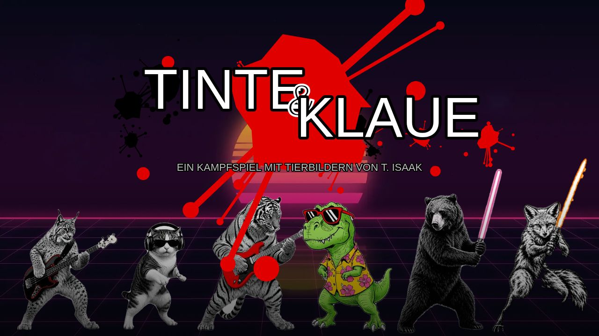
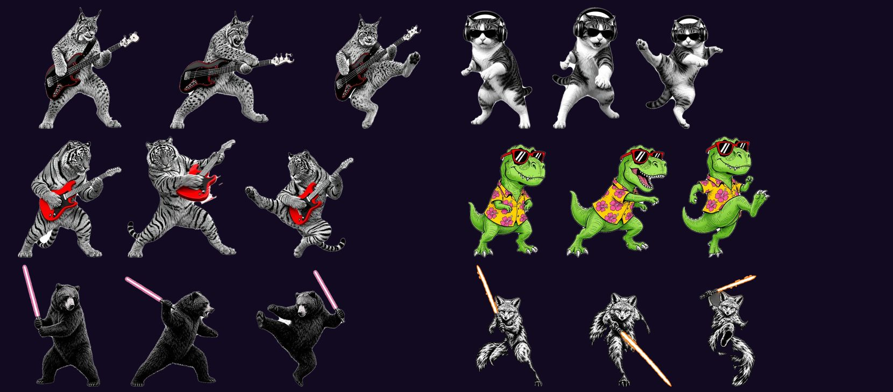
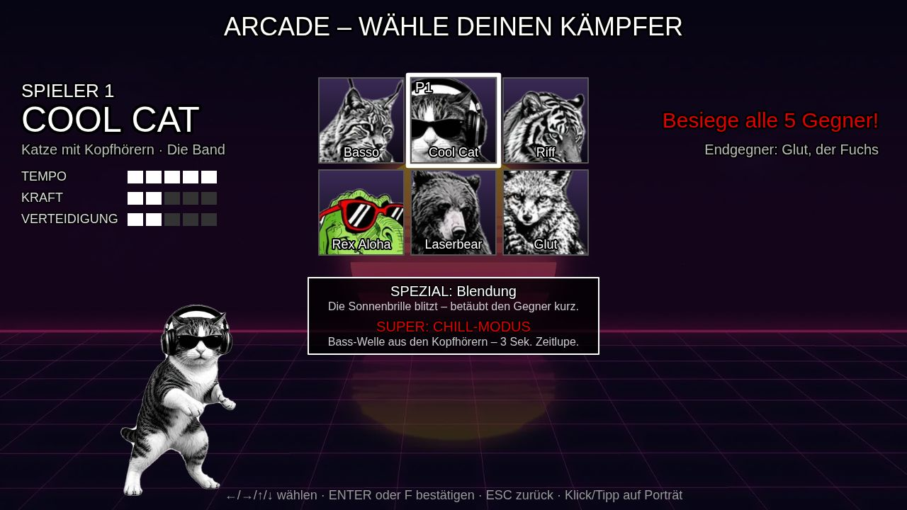
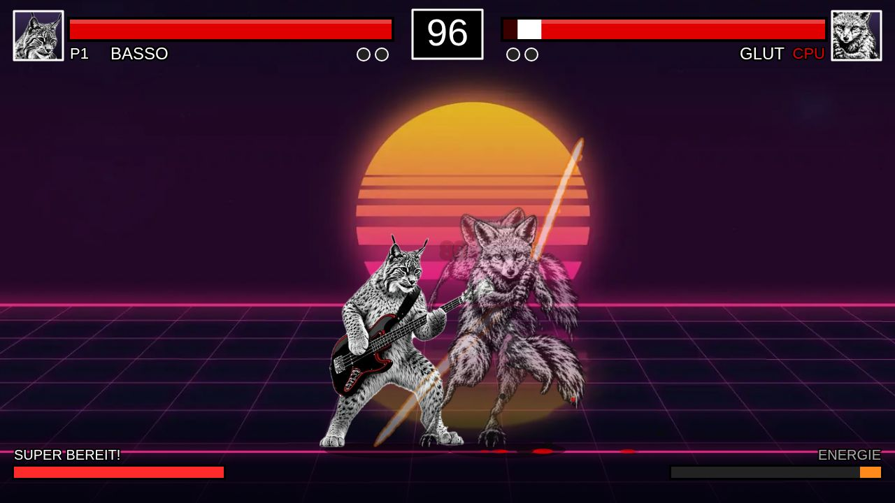
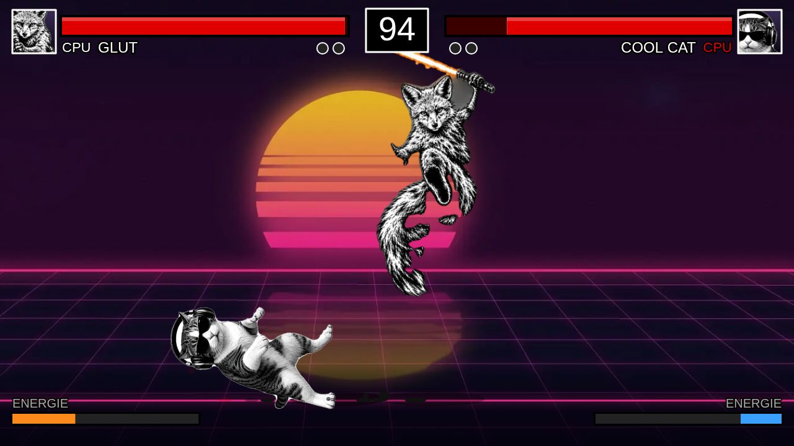
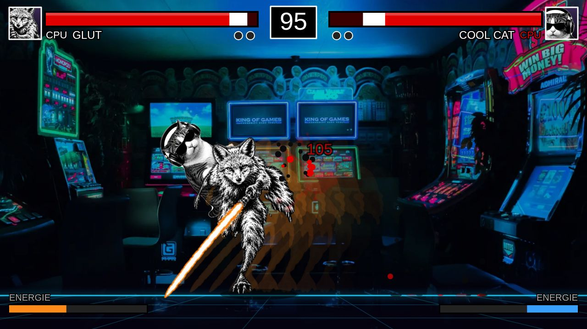
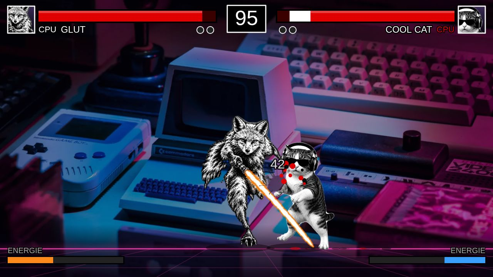
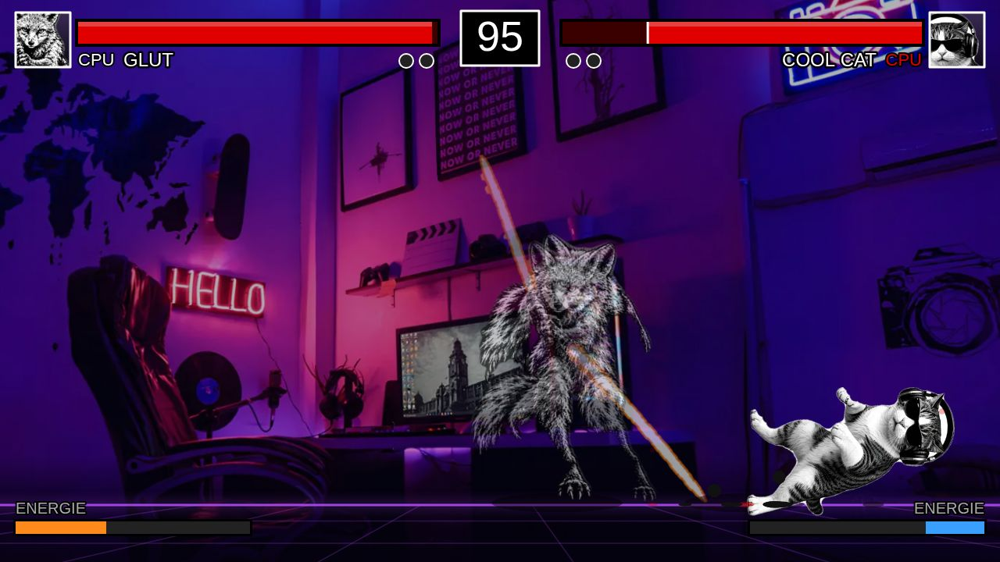

# Tinte & Klaue

**Ein Kampfspiel im Browser – mit Tierbildern, die ich selbst gemalt habe.**



Ich male gern Tiere, meist als Schablonen-Kunst oder Tuschezeichnung: schwarz-weiß, mit einem einzigen Farbakzent. Irgendwann kam die Frage: *Was wäre, wenn diese Figuren gegeneinander kämpfen könnten?* Also habe ich meine Bilder [Claude](https://claude.ai) gegeben – und eins kam zum anderen.

🎮 **[Direkt im Browser spielen](https://disciple-ti.github.io/tinte-und-klaue/)**

---

## Die Kämpfer

| | Kämpfer | Tempo / Kraft / Vert. | Spezialattacke | Super-Attacke |
|---|---|:---:|---|---|
| 🎸 | **Basso** – Luchs mit E-Bass | 4 / 2 / 3 | Bass-Druckwelle am Boden | **DROP** – der Boden bebt, nur Springen hilft |
| 🎧 | **Cool Cat** – Katze mit Kopfhörern | 5 / 2 / 2 | Blendung – die Sonnenbrille blitzt | **CHILL-MODUS** – Bass-Welle, 3 Sek. Zeitlupe |
| 🎸 | **Riff** – Tiger mit E-Gitarre | 3 / 4 / 2 | Gitarrenschwung (3 Treffer) | **POWER-CHORD** – riesige Klangwelle |
| 🌺 | **Rex Aloha** – T-Rex im Hawaiihemd | 2 / 5 / 2 | Schwanzfeger (wirft um) | **HIBISKUS-STURM** – Blütenregen |
| 🗡️ | **Laserbear** – Bär mit Laserschwert | 2 / 4 / 3 | Schwertwurf als Bumerang | **LASER-WIRBELSTURM** |
| 🔥 | **Glut** – Fuchs mit Glutschwertern | 4 / 3 / 2 | Glutsprung durch den Gegner | **FEUERWIRBEL** – 6 Glutschwert-Hiebe |

Alle Kämpfer sind ausbalanciert: Die Summe aus Tempo, Kraft und Verteidigung ist immer 9.

### Drei Haltungen pro Kämpfer



Jeder Kämpfer hat drei Körperhaltungen, zwischen denen im Kampf mit einer kurzen Überblendung gewechselt wird:

| Haltung | wird gezeigt bei |
|---|---|
| 1 – Grundstellung | Stehen, Laufen, Ducken, Blocken, Treffer einstecken, am Boden liegen |
| 2 – Angriff | allen Angriffen am Boden, Spezial- und Super-Attacken |
| 3 – Sprung/Kick | Springen, Sprungangriffen und als Siegerpose |

Die Zuordnung steht im Code in `HALTUNG_FUER` und lässt sich dort ändern. Einzelne Angriffe können mit dem Feld `haltung: 1|2|3` eine eigene Haltung bekommen.

<p>
  
  
  
  
  
  
</p>

## Features

- **Arcade** – nacheinander gegen alle anderen Kämpfer, Endgegner ist Glut
- **Duell gegen CPU** – Kämpfer, Gegner und Arena frei wählbar
- **2 Spieler an einer Tastatur** – mit Siegstatistik für die Sitzung
- **KI gegen KI** – zum Zuschauen
- **KI** als Zustandsautomat mit drei Schwierigkeitsstufen (reagiert auf Angriffe, blockt, springt über Projektile)
- **Kampfsystem** mit Block (hoch/tief), 3er-Combo mit Finisher, Energieleiste, Super-Attacken mit Einblendung, Hitstop und Bildschirmwackeln
- **4 Arenen**: Neon-Horizont, Spielhalle, Retro-Schreibtisch, Gaming-Zimmer – mit Parallaxe und Neon-Boden
- **Sound & Musik** komplett per Web Audio API erzeugt – keine Audiodateien
- **Touch-Steuerung** im Einzelspieler auf Tablets und Handys
- Tastenbelegung, Einstellungen und Statistik werden im Browser gespeichert

## Steuerung

| Aktion | Spieler 1 | Spieler 2 |
|---|:---:|:---:|
| Laufen | A / D | ← / → |
| Springen | W | ↑ |
| Ducken | S | ↓ |
| Leichter Angriff | F | Num 1 oder J |
| Schwerer Angriff | G | Num 2 oder K |
| Block | H | Num 3 oder L |
| Spezialattacke | R | Num 4 oder I |
| Super-Attacke | T | Num 5 oder O |

**Esc** = Pause · **M** = Ton an/aus · **F1** = Trefferboxen anzeigen

Tipps: Dreimal leichter Angriff hintereinander löst einen Finisher aus. Tiefe Angriffe lassen sich nur geduckt blocken, Sprungangriffe nur im Stehen. Alle Tasten lassen sich unter *Optionen* neu belegen.

## Technik

- **Eine einzige HTML-Datei** (`index.html`, ca. 1,2 MB) – HTML, CSS und JavaScript inline, alle Bilder als Base64 eingebettet
- **Keine Frameworks, keine Bibliotheken**, kein Build-Schritt nötig zum Spielen
- Canvas mit fester Auflösung 1280×720, responsiv skaliert
- Spielschleife mit fester Physik-Schrittweite (60 Updates/s), unabhängig von der Bildwiederholrate
- Eingabe über `event.code` – funktioniert auf QWERTZ und QWERTY gleich
- Code und Kommentare auf Deutsch

### Projektstruktur

```
index.html                         fertiges Spiel (wird von tools/build.py erzeugt)
src/tinte-und-klaue.template.html  Quellcode des Spiels (ohne eingebettete Bilder)
img/                               <id>_haltung1..3.webp (Kämpfer) und hintergrund_*.webp (Arenen, Menü)
tools/prep.py                      Bildaufbereitung: Blätter zerlegen, freistellen, ausrichten, verkleinern
tools/build.py                     bettet img/ in die Vorlage ein und schreibt index.html
tools/test.js                      automatischer Browsertest mit Playwright
tools/test-2spieler.js             Test für gleichzeitige Eingaben im 2-Spieler-Modus
docs/screenshots/                  Bilder für diese Seite
```

### Selbst bauen

```bash
python3 tools/build.py            # index.html neu erzeugen
```

Neue Kämpfer: ein Bild mit den 3 Haltungen nebeneinander nach `originale/` legen, in `tools/prep.py` unter `BLAETTER` eintragen (Hintergrund weiß, schwarz oder Schachbrett), `python3 tools/prep.py` ausführen. Das Skript schneidet die Haltungen aus, stellt sie frei und legt alle drei auf eine gleich große Leinwand mit gemeinsamer Fußlinie. Danach in der Vorlage die ID in `CHARAKTER_IDS`, einen Eintrag in `CHARAKTERE` und die Attacken in `erstelleAttacken()` ergänzen.

Tests (Node.js + Playwright):

```bash
npm install playwright && npx playwright install chromium
node tools/test.js
```

Wer das Spiel lieber mit Bildern aus dem Ordner statt eingebettet ausliefern möchte, setzt in der Vorlage `BILDER_AUS_ORDNER = true` und lädt `img/` mit hoch.

## Entstehung

Die Bilder sind von mir. Das Spiel habe ich zusammen mit Claude (Anthropic) entwickelt: Ich habe Idee, Figuren und Richtung vorgegeben, Claude hat die Bilder freigestellt und den Code geschrieben.

## Lizenz

- **Code** (HTML, CSS, JavaScript, Python-Skripte): [MIT-Lizenz](LICENSE)
- **Bilder und Zeichnungen** (`img/`, `docs/screenshots/` sowie die in `index.html` eingebetteten Bilder): © Tobias Isaak, **alle Rechte vorbehalten** – siehe [LICENSE-BILDER.md](LICENSE-BILDER.md)
